# Mermaid — Diagrams from Text

Mermaid turns indented text into a diagram. Twenty-odd types — flowchart, sequence, state, ER, class, gantt,
gitGraph, mindmap, timeline, quadrant, sankey, architecture — share one grammar: you write structure, it lays out.

That is the point. **Mermaid is a thinking tool that happens to produce a design asset** — you sketch boxes to
find out whether you understand the system, and the sketch survives as something reviewable: it diffs in a PR,
gets commented on line by line, and cannot rot silently like an exported PNG. No canvas, no export step.

## Choose the diagram

| Question you are answering | Diagram | First line |
| --- | --- | --- |
| What happens, in what order, with what branches? | Flowchart | `flowchart LR` |
| Who calls whom, and when? | Sequence | `sequenceDiagram` |
| What states can this thing be in? | State | `stateDiagram-v2` |
| What are the tables and how do they relate? | ER | `erDiagram` |
| What are the classes / modules and their edges? | Class | `classDiagram` |
| When does each workstream land? | Gantt | `gantt` |
| How do branches and releases diverge? | gitGraph | `gitGraph` |
| What is inside this idea? | Mindmap | `mindmap` |
| When did this happen, and in what order? | Timeline | `timeline` |
| What should we do first? | Quadrant | `quadrantChart` |
| Where does the traffic / money actually go? | Sankey | `sankey-beta` |
| How does one metric move over time? | XY chart | `xychart-beta` |
| What talks to what in the deployed system? | Flowchart + subgraphs, `block-beta`, `architecture-beta` | `flowchart LR` |
| What is in flight right now? | Kanban | `kanban` |

If two types fit, pick the one whose *reading order* matches how you explain it out loud. **Skip Mermaid for**
illustration, pixel-exact infographics, dashboards, or anything past ~20 nodes that must fit on a slide.

## Install and render

Native fenced ` ```mermaid ` blocks render in GitHub READMEs, issues, PRs and wikis, in GitLab markdown, in
Obsidian, Notion and the VS Code preview, and in docs frameworks via plugin. Install with `npm i mermaid`
(current line is **12.x**), then:

```js
import mermaid from "mermaid";
mermaid.initialize({
  startOnLoad: true,
  theme: "neutral",
  look: "handDrawn",                    // v11.3+; handDrawnSeed: 42 pins the wobble
  fontFamily: "Inter, system-ui, sans-serif",
  flowchart: { curve: "basis", htmlLabels: false },
  securityLevel: "strict",
});
await mermaid.run({ nodes: [el], suppressErrors: true });   // late-inserted nodes
```

**SSR caveat.** Mermaid measures text inside a real DOM, so it never renders on the server — render after
hydration, or pre-render at build time with `mmdc`. `mermaid.render(id, text)` needs `document` too.

**Version note.** 12.0.0 is a major bump from 11.17.x; 12.2.0 is current at the time of writing. The grammar
here is the long-stable core shared by 10.x and 11.x; the JS surface (`initialize`, `run`, `parse`, CLI flags)
is what moves across majors — pin it, read the 12.0.0 notes before upgrading, and `parse()` everything in CI.

Two v12 details worth knowing, both from the config schema: `look` now defaults to **`neo`** (allowed values are
`classic | handDrawn | neo`), so a diagram rendered with defaults no longer matches v11 screenshots — pass
`look: "classic"` for the old geometry, or `handDrawn` for a sketch feel. The built-in theme list also gained
`neo` and `neo-dark` alongside `default`, `neutral`, `forest`, `dark` and `base`.

## Syntax core

### Flowchart — shapes, edges, structure, style

Shapes: `A[Rect]` step · `A(Rounded)` actor · `A([Stadium])` terminal · `A[[Subroutine]]` service · `A[(Cylinder)]`
store · `A((Circle))` · `A{Diamond}` decision · `A{{Hexagon}}` prep · `A[/Input/]` · `A>Output]` · `A(((Done)))`.

Edges: `-->` arrow · `---` open · `-.->` dotted · `==>` thick · `--o` / `--x` terminals · `<-->` both ways;
label either side: `A -- retries 3x --> B` or `A -->|retries 3x| B`.

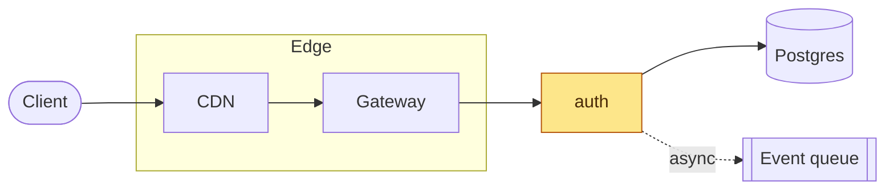

`classDef` declares (`fill:…,stroke:…,color:…`), `class a,b name` applies it, `A:::name` applies it inline.
`linkStyle 3 stroke:#f97316` restyles one edge by index — brittle the moment you add a line.

### Sequence — participants, blocks, notes

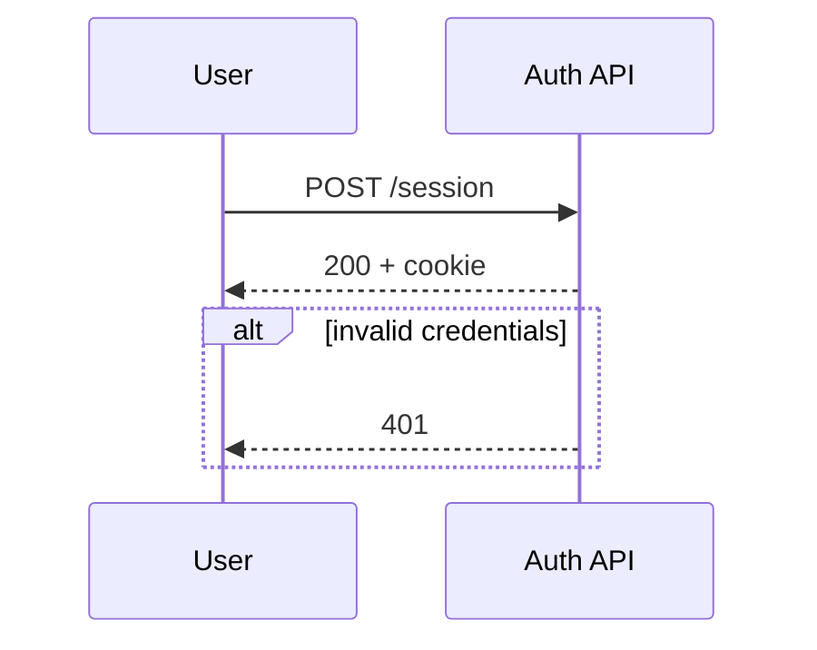

`->>` solid, `-->>` reply, `-)` async, `--x` failure; `alt/else`, `opt`, `loop`, `par` and `critical` all close
with `end`, and `rect rgb(238,242,255)` tints a region.

### State, ER, gantt

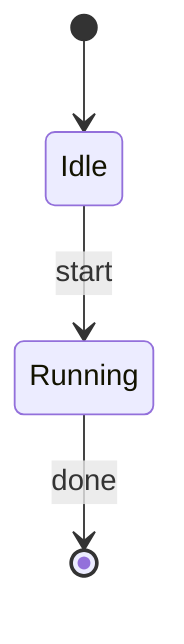
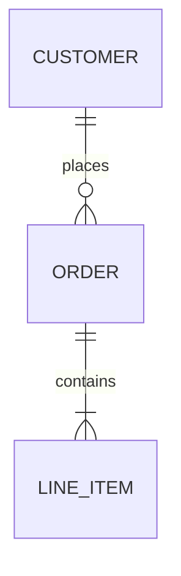
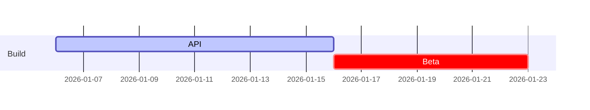

State composites nest as `state Name { … }`; `<<fork>>`, `<<join>>`, `<<choice>>` cover concurrency. ER reads
`||` one, `|o` zero or one, `}o` zero or many, `}|` one or many; gantt uses `after <id>` and `:milestone`.

### Mindmap, timeline, quadrant, sankey

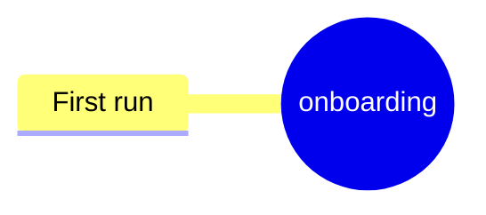
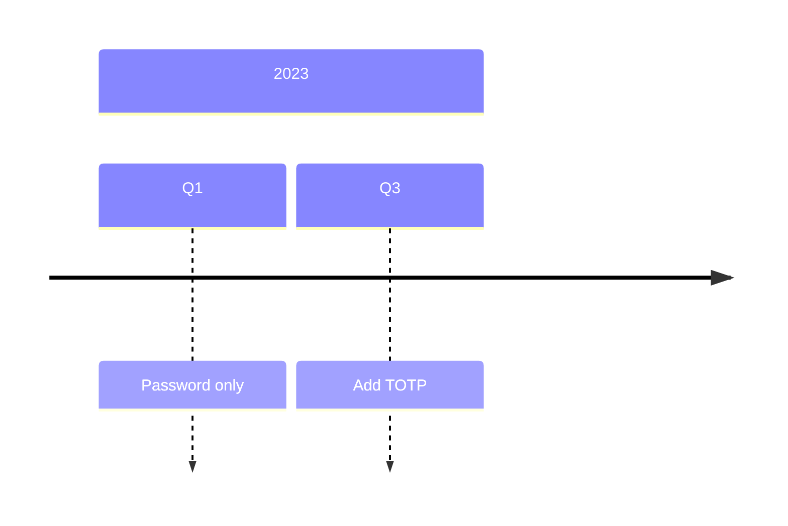
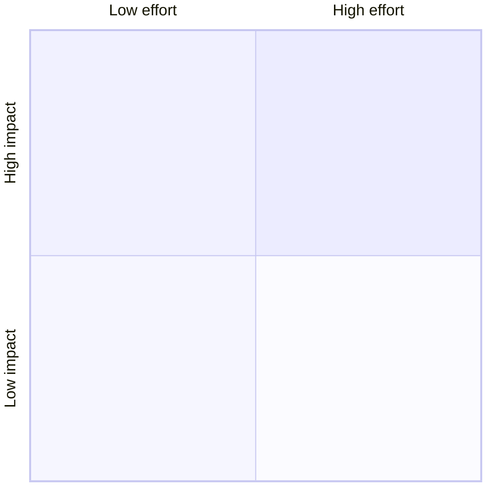
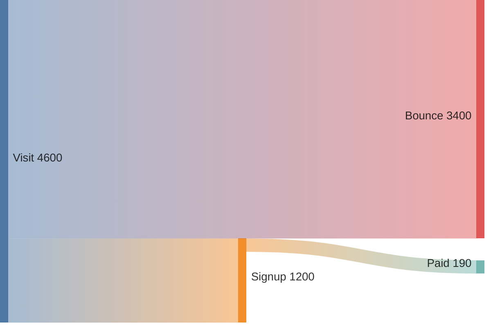

Sankey is CSV — `source,target,value`, quote fields with commas; `-beta` still applies to sankey, xychart, block and friends.

## Design quality

- **Theme:** `neutral` for docs and READMEs, `dark` for dark surfaces, `base` when you want to brand it,
  `forest` almost never — `default` is the lavender look everyone recognises as auto-generated.
- **Override variables, not CSS.** On `theme: "base"` set `primaryColor`, `primaryBorderColor`,
  `primaryTextColor`, `lineColor`, `fontFamily` and stop; `themeCSS` is for the last 5% and breaks on upgrade.
- **Short labels, one idea per node.** Two lines via `<br/>` beat one 40-character line; verb-first for actions.
- **One direction.** `LR` for request paths and pipelines, `TB` for hierarchies. If a subgraph fights the flow,
  give it its own `direction TB` instead of letting the ranker improvise.
- **Cap it at ~12 nodes.** Past that, group with subgraphs to shorten edges and kill crossings, or split into
  two diagrams — a diagram that needs scrolling has already failed.
- **Soft or sharp, pick one.** `curve: "basis"` for organic edges, `"linear"` / `"step"` for engineering;
  `look: "handDrawn"` with a fixed `handDrawnSeed` only when the brand is sketchy — never on architecture.
- **Colour is emphasis.** Two `classDef`s — one muted default, one highlight. Three colours maximum.
- **Export honesty.** `flowchart.htmlLabels: false` renders labels as SVG `<text>`: identical fonts in browser
  and `mmdc` output, no `foreignObject`. Trade-off: HTML markup inside labels stops working.

```js
mermaid.initialize({
  theme: "base",
  themeVariables: { primaryColor: "#eef2ff", primaryBorderColor: "#4f46e5",
    lineColor: "#475569", fontFamily: "Inter, system-ui, sans-serif" },
  flowchart: { curve: "basis", padding: 12, nodeSpacing: 40, rankSpacing: 50 },
});
```

## Two worked examples

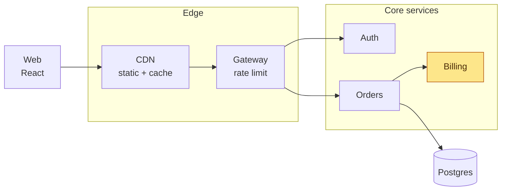
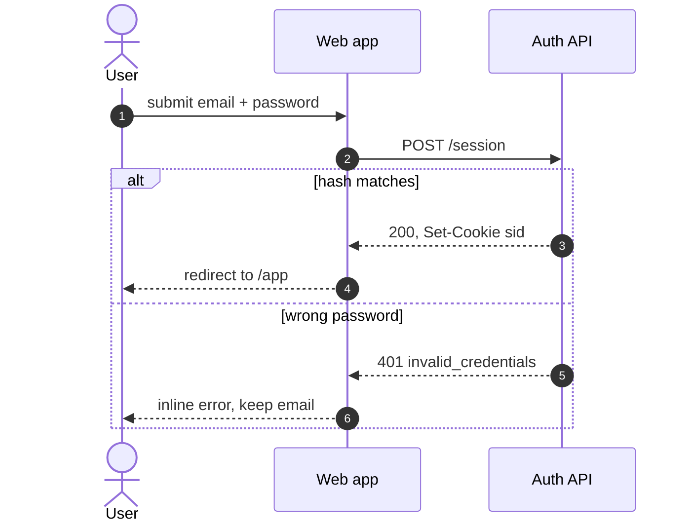

## Export pipeline

`mmdc` wraps headless Chromium and turns `.mmd` files into SVG, PNG or PDF in CI:

```bash
npm i -D @mermaid-js/mermaid-cli

mmdc -i docs/arch.mmd -o docs/arch.svg      -t neutral -b transparent -c mermaid.json
mmdc -i docs/arch.mmd -o docs/arch-dark.svg -t dark    -b "#0b1020"
mmdc -i docs/arch.mmd -o docs/arch.png      -w 2000 -s 2
mmdc -i docs/arch.mmd -o docs/arch.pdf      -f
```

`-b transparent` matters for SVG and PNG; `-s 2` renders at 2× before downscaling, the only thing that makes a
PNG acceptable. CI Chromium usually needs `-p puppeteer.json` with `--no-sandbox`.

**Prefer SVG.** It stays crisp at any DPR, weighs less than a 2× PNG, keeps text searchable and is themable by
CSS. PNG is for surfaces that reject SVG: slide importers, chat previews, store listings. Sanitise before
publishing — strip `<script>`, `on*` attributes and, for strict-CSP or email, the `foreignObject` labels
(`htmlLabels: false` avoids them). Commit the `.mmd` beside its output and reference the generated `docs/arch.svg` from the markdown.

## Pitfalls

- **Silent failure.** A syntax error renders as an empty box, or nothing, in several integrations. Run
  `mermaid.parse(source)` in a jsdom test and fail the build; never rely on eyeballing the README.
- **`;` ends a statement** in flowcharts, so a label containing one truncates the line; a bare node id `end`
  closes a subgraph early. Same family of bug, different symptom.
- **Parentheses, brackets, braces and `#` in labels** need quoting: `A["Deploy (canary)"]`. Use `#35;` for a
  literal `#` and `#quot;` for a quote inside an already-quoted label.
- **`htmlLabels` + `securityLevel: "strict"`** sanitises markup: `<b>`, `<br/>` and entities survive, iframes
  and handlers do not. Drop to `"loose"` only for content you authored.
- **ELK is opt-in.** `layout: "elk"` needs `mermaid.registerLayoutLoaders` (`@mermaid-js/layout-elk`) plus
  bundle weight — only for dense wide graphs, not worth it otherwise.
- **Hosted renderers lag npm.** GitHub, GitLab and Notion pin their own Mermaid builds, so bleeding-edge syntax
  and front-matter config can fail there while working locally. If it must render in a README, test it there.
- **Beta types move.** `sankey-beta`, `xychart-beta`, `block-beta`, `kanban`, `architecture-beta` and friends
  are usable but not frozen. Mermaid also emits a fixed width — override with `useMaxWidth: true` or
  `svg { max-width: 100%; height: auto; }`, because past ~12 nodes it is unreadable on a phone regardless.

## Checklist before shipping

- [ ] Diagram type matches the question, not the aesthetic
- [ ] ≤ 12 nodes, one direction, subgraphs used to shorten edges
- [ ] Theme plus 4–5 `themeVariables`; at most two `classDef`s, one highlight
- [ ] Labels short, quoted where they contain `()[]{}#;`, `<br/>` for second lines; `accTitle` / `accDescr` set
- [ ] `mermaid.parse()` passes in CI for every `.mmd` and fenced block you own
- [ ] Rendered check on GitHub/GitLab, not just locally — hosted Mermaid versions lag
- [ ] Exported SVG committed, transparent background, `.mmd` source beside it

Long tail: `references/syntax-cheatsheet.md` — 18 diagram starters, the theme-variable table, `mmdc` flags.
