# Mermaid syntax cheatsheet

Every block below is copy-pasteable into [mermaid.live](https://mermaid.live) or a ` ```mermaid ` fence.
Paired with `SKILL.md`, which carries the judgement; this file carries the vocabulary.

## Flowchart

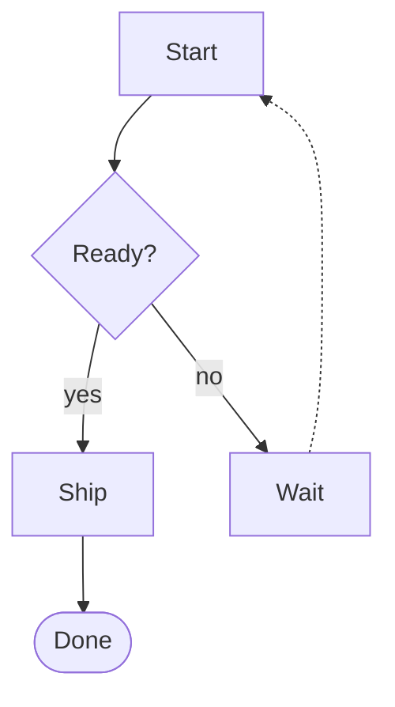

Chained edges (`a --> b --> c`), `linkStyle 0 stroke:#f97316`, and `classDef` / `class` / `A:::name` all work.
`click A "https://..."` needs `securityLevel: "loose"` — leave it out of docs you do not control.

## Sequence

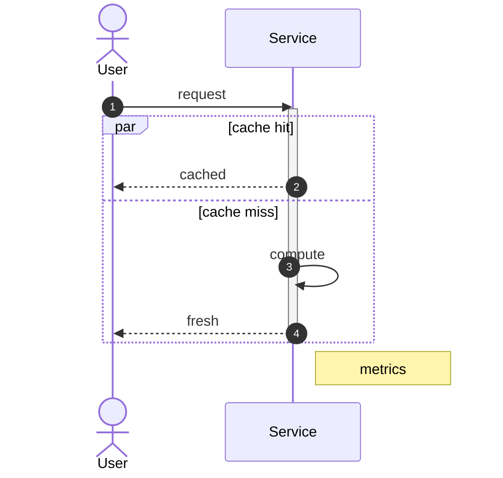

Blocks: `alt/else`, `opt`, `loop`, `par/and`, `critical`, `break`; every one closes with `end`. `rect rgb(...)`
tints a region, `box` groups participants.

## Class

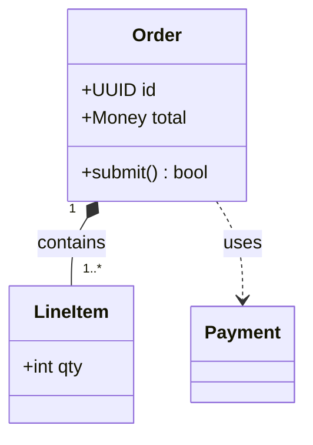

Relations: `<|--` inheritance, `*--` composition, `o--` aggregation, `-->` association, `..>` dependency,
`..|>` realisation. Multiplicities sit in quotes next to each end.

## State

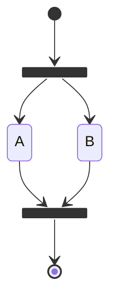

`<<choice>>` for branching, `state Name { … }` for composites, `direction LR` inside a composite.

## ER

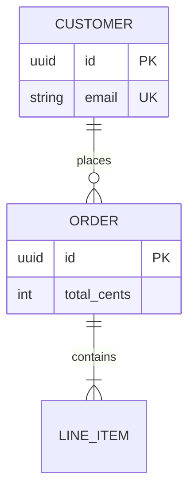

Attribute keys: `PK`, `FK`, `UK`, optionally combined (`PK, FK`). Comments go in quotes after the key.

## Gantt

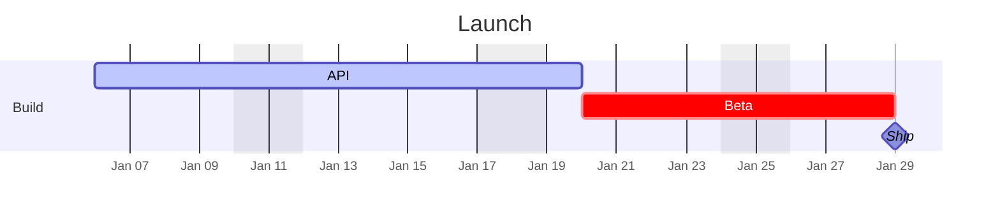

Tags: `done`, `active`, `crit`, `milestone`. Durations are `10d`, `4h`, `2w`, or an end date.

## gitGraph

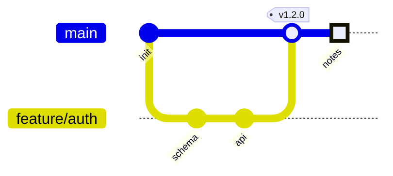

`type:` is `NORMAL`, `REVERSE` or `HIGHLIGHT`; `cherry-pick id: "schema"` replays a commit.

## Mindmap

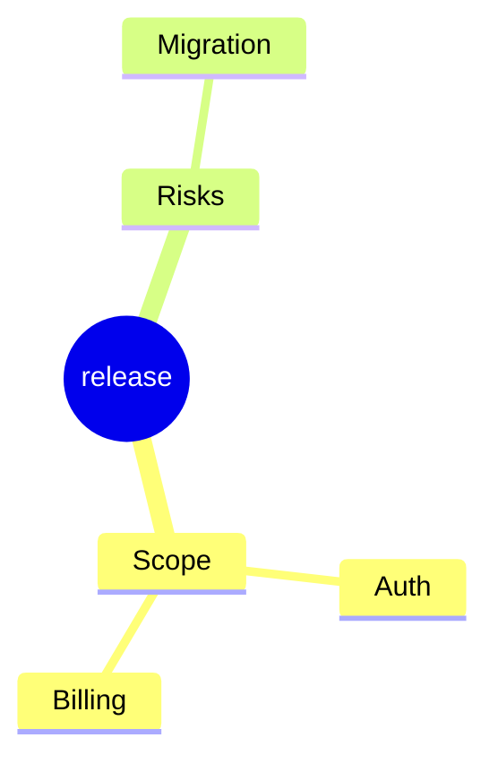

Indentation is the whole grammar. Optional shapes: `[square]`, `(rounded)`, `((circle))`, `))bang((`,
`)cloud(`, `{{hexagon}}`.

## Timeline

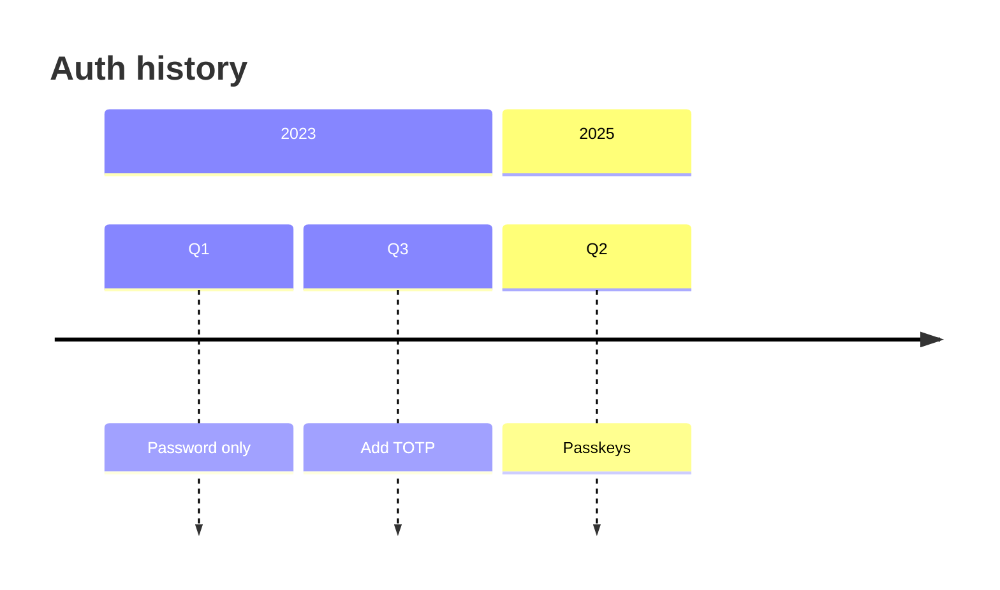

Multiple events on one period: `Q3 : Add TOTP : Add recovery codes`.

## Quadrant

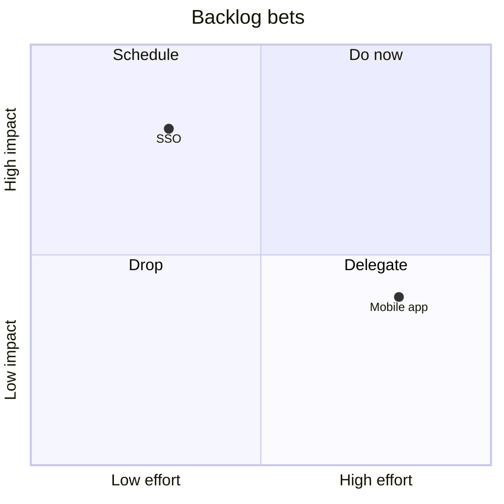

Coordinates are 0–1, `[x, y]`, and the point label is whatever precedes the colon.

## Sankey

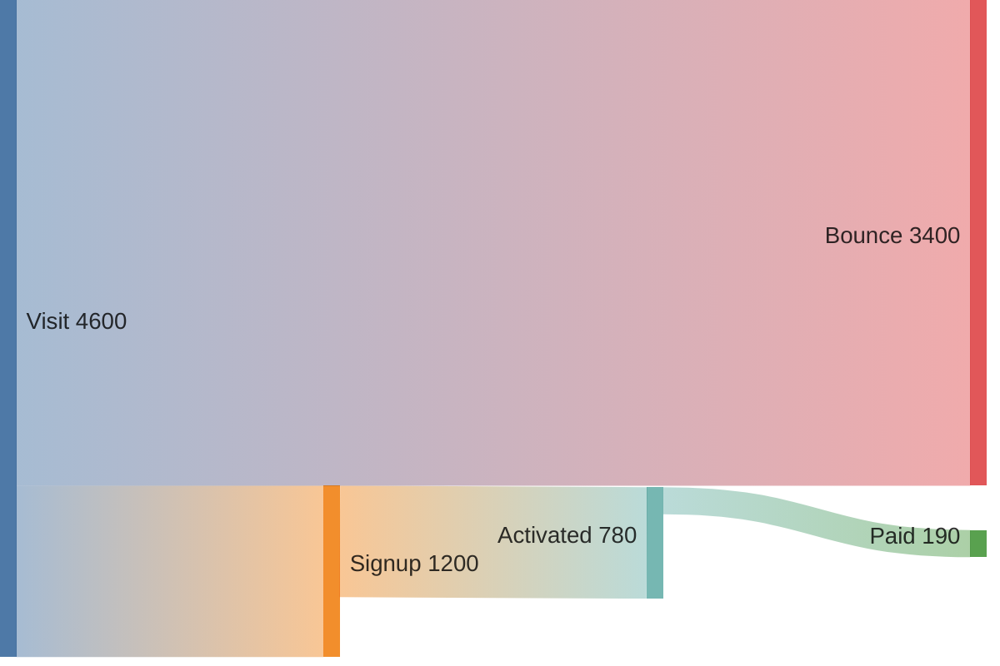

Config: `sankey: { linkColor: "gradient", nodeAlignment: "justify", showValues: true }`.

## XY chart

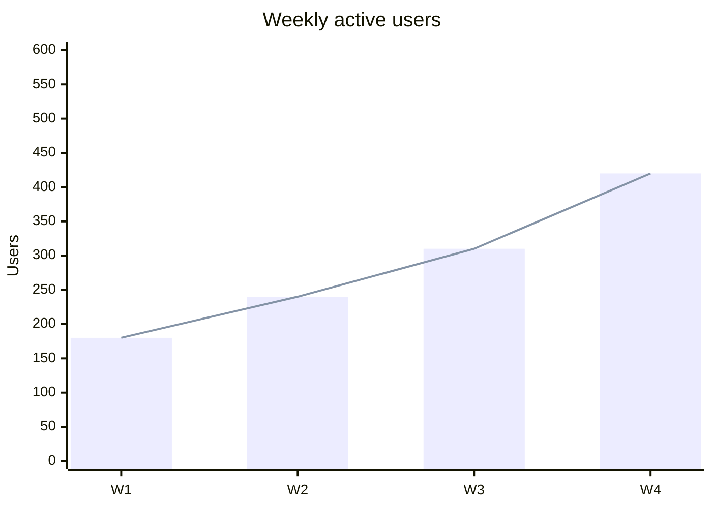

`x-axis` also accepts a range (`x-axis 0 --> 100`) or categorical labels in brackets — not both.

## Block

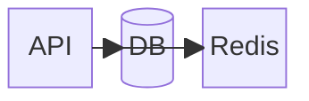

`space` and `space:N` leave gaps; `blockArrowId<["label"]>(right)` draws arrowing containers.

## Kanban

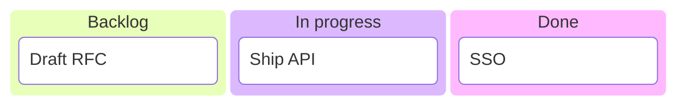

Cards can carry metadata (`ticket`, `assigned`, `priority`) through the `@{ … }` suffix; the exact shape has
shifted between minors, so check it in the Live Editor against your pinned version before committing.

## Architecture

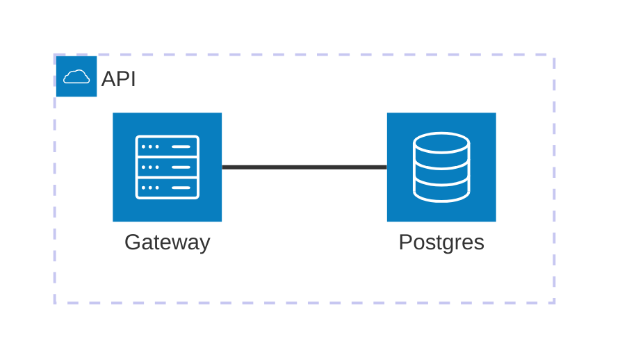

Endpoints are `service:{L,R,T,B}`; built-in icons include `cloud`, `server`, `database`, `disk`, `internet`.

## Packet

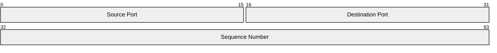

Bit ranges are inclusive and must not overlap; each line is one field of the frame.

## Treemap

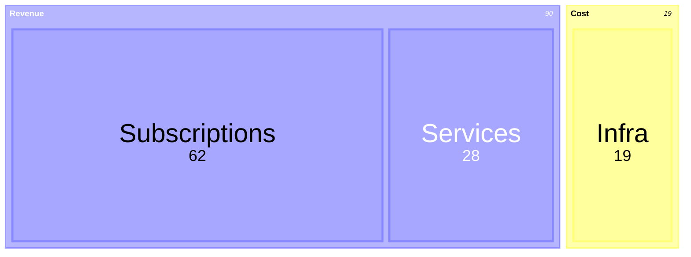

Quoted sections contain quoted leaves with a numeric value; nesting deeper adds another level.

## Radar

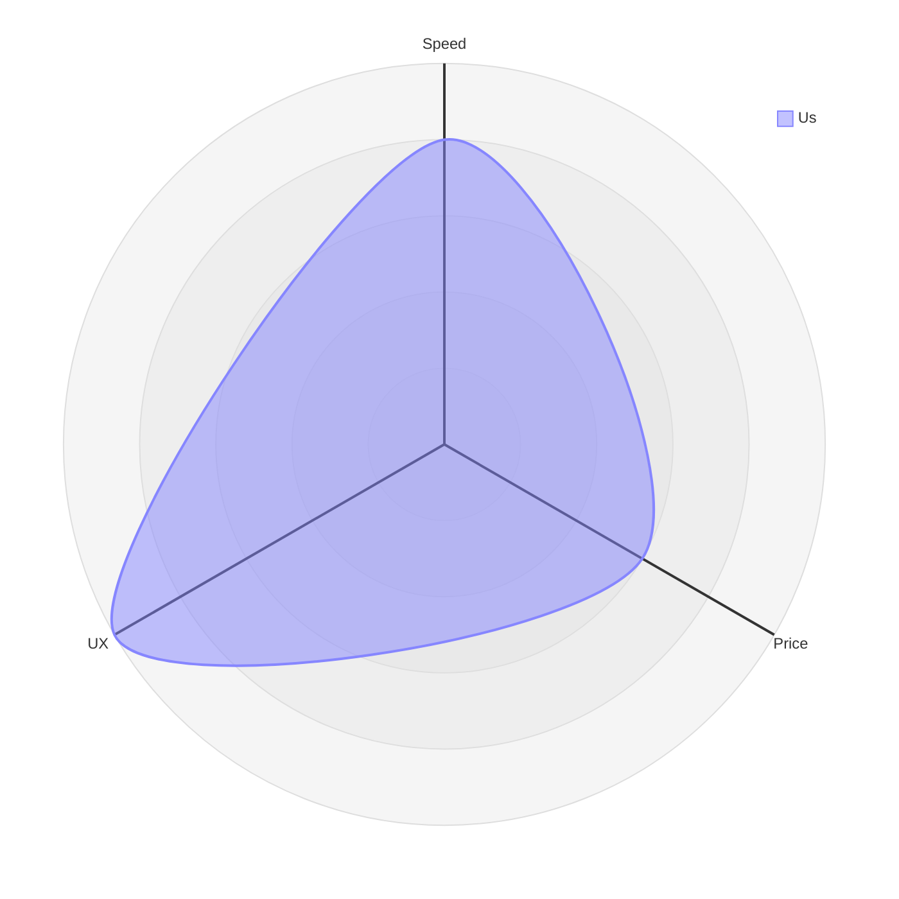

`ticks 4` and `graticule circle` change the grid; curve values map to the axes in declaration order.

## Theme variables that matter

| Variable | Controls |
| --- | --- |
| `primaryColor` | node / actor fill |
| `primaryTextColor` | text inside nodes |
| `primaryBorderColor` | node borders |
| `lineColor` | edges and connectors |
| `secondaryColor` / `tertiaryColor` | alternate cluster shades |
| `background` | diagram background |
| `mainBkg` / `nodeBorder` | per-node overrides |
| `clusterBkg` / `clusterBorder` | subgraph fill and border |
| `edgeLabelBackground` | plate behind edge labels |
| `fontFamily` / `fontSize` | all diagram text |
| `titleColor` | titles and `accTitle` |
| `actorBkg` / `actorBorder` / `actorTextColor` | sequence actors |
| `signalColor` / `signalTextColor` | sequence arrows and their labels |
| `noteBkgColor` / `noteBorderColor` / `noteTextColor` | notes |
| `activationBkgColor` | activation bars |
| `sectionBkgColor` / `altSectionBkgColor` | gantt sections |
| `taskBkgColor` / `taskTextColor` | gantt bars |
| `gridColor` / `todayLineColor` | gantt grid and today marker |
| `pie1` … `pie12` | pie slices |
| `git0` … `git7` | git branch colours |
| `quadrant1Fill` … `quadrant4Fill` | quadrant background fills |
| `cScale0` … `cScale11` | colour scale used by mindmap and friends |

`themeVariables` are most predictable on `theme: "base"`; the packaged themes (`default`, `neutral`, `dark`,
`forest`) already set many of the same keys, so overrides can lose to the theme.

## Config keys worth knowing

| Key | Values | Note |
| --- | --- | --- |
| `theme` | `default`, `neutral`, `dark`, `forest`, `base`, `null` | `base` for custom variables, `null` for raw CSS |
| `look` | `classic`, `handDrawn` | `handDrawn` is v11.3+; pair with `handDrawnSeed` |
| `layout` | `dagre`, `elk` | `elk` requires `registerLayoutLoaders` |
| `securityLevel` | `strict`, `loose`, `antiscript`, `sandbox` | `strict` sanitises HTML labels |
| `fontFamily` | CSS stack | applied to every diagram type |
| `themeCSS` | CSS string | last resort; survives upgrades poorly |
| `flowchart.htmlLabels` | boolean | `false` → SVG `<text>`, predictable exports |
| `flowchart.curve` | `basis`, `linear`, `step`, `stepBefore`, `stepAfter` | edge smoothing |
| `flowchart.padding` / `nodeSpacing` / `rankSpacing` | number | layout breathing room |
| `deterministicIds` | boolean | stable SVG ids for snapshot tests |
| `maxTextSize` / `maxEdges` | number | guard rails, defaults 50000 / 500 |

## `mmdc` flags

| Flag | Use |
| --- | --- |
| `-i` / `-o` | input `.mmd`, output `.svg` / `.png` / `.pdf` |
| `-t` | theme override (`neutral`, `dark`, …) |
| `-b` | background (`transparent` or `#0b1020`) |
| `-c` | JSON config file (same shape as `initialize`) |
| `-C` | extra CSS file |
| `-s` | scale factor; `2` for retina PNG |
| `-w` / `-H` | width / height in pixels |
| `-f` | fit the diagram to the PDF page |
| `-p` | puppeteer config (CI `--no-sandbox`) |

## Characters that break labels

| Character | Handling |
| --- | --- |
| `;` | statement separator in flowcharts — avoid it, or quote the label |
| `(` `)` `[` `]` `{` `}` | wrap the label in quotes: `A["Deploy (canary)"]` |
| `#` | `#35;` |
| `"` inside a quoted label | `#quot;` |
| newline | `<br/>` (requires `htmlLabels: true`, the default) |
| `%%` at line start | comment; the rest of the line is ignored |
| bare `end` as a node id | closes a subgraph — quote it or rename |

## Beta types

`sankey-beta`, `xychart-beta`, `block-beta`, `packet-beta`, `architecture-beta`, `treemap-beta`, `radar-beta`
render fine but their grammar can still change between minors, and `kanban` has changed more than once in the
11.x line. Pin the Mermaid version in any CI that renders them.
